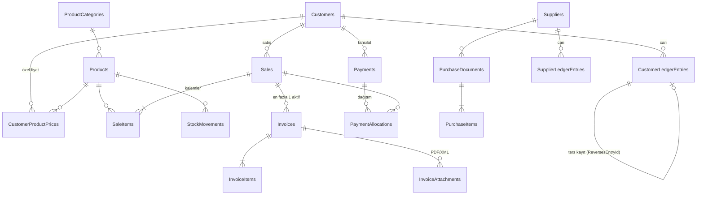

# Veritabanı Tasarımı

PostgreSQL 16, EF Core 10 (Npgsql). Şema `src/SutTicaretCRM.Infrastructure/Persistence/AppDbContext.cs` içinde tanımlıdır; migration'lar `Persistence/Migrations` altındadır.

## 1. Kurallar

* **Para:** `numeric(18,2)`. Birim fiyat `numeric(18,4)`, miktar `numeric(18,3)`, oran `numeric(5,2)`. Kodda `decimal`; `double/float` yoktur.
* **Anahtarlar:** `uuid` (v7, zamana göre sıralı; istemci tarafında üretilir). Sıralama gereken hareket tablolarında ayrıca `Seq bigint GENERATED ALWAYS AS IDENTITY`.
* **Enum'lar** metin olarak saklanır (okunabilir, sıralamadan bağımsız).
* **Tarih:** iş günü alanları `date` (`DateOnly`), kayıt zamanları `timestamptz` (UTC).
* **Silme yok:** finansal tablolar `ON DELETE RESTRICT`; hata düzeltmesi **ters kayıt** veya durum değişikliğiyle yapılır. Yalnızca "kalem" tabloları üst belgeyle birlikte silinir (`CASCADE`) ve yalnızca *taslak satış* düzenlemesinde kullanılır.
* **Eşzamanlılık:** `Sales`, `Invoices`, `Payments`, `PurchaseDocuments` tablolarında `xmin` sürüm jetonu.
* **Numaralar:** `NumberSequences (Key, LastValue)`; `INSERT … ON CONFLICT DO UPDATE … RETURNING` ile aynı işlemde üretilir (işlem geri alınırsa numara da geri alınır). Biçim: `SAT-2026-000001`, `THS-…`, `TSL-…` (fatura taslağı iç ref.), `ACL-…` (açılış), `IAD/DZL/MNL` (iade/düzeltme/manuel), `ALS-…` (alış), `ODM-…` (tedarikçi ödemesi), `ACT-…` (tedarikçi açılışı).

## 2. İlişki diyagramı



## 3. Tablolar

| Tablo | Amaç / önemli sütunlar |
|---|---|
| `Users` | Kullanıcı adı (benzersiz), PBKDF2 özeti, başarısız giriş sayısı, kilit bitişi |
| `AppSettings` | Anahtar/değer: firma bilgisi, KDV oranları, birimler, negatif stok, fatura sağlayıcısı, `db.mode` (Live/Demo) |
| `NumberSequences` | Yıl bazlı sayaçlar |
| `AuditLogs` | Zaman, kullanıcı, işlem, varlık türü/kimliği, kısa ayrıntı (kişisel veri yok) |
| `Customers` | Ad, tip, VD, `TaxNumber`(10) / `NationalId`(11) (kısmi benzersiz), iletişim, `PaymentTermDays`, `EInvoiceStatus` (Unknown varsayılan), aktif |
| `Suppliers` | Müşteriye benzer, hafif |
| `ProductCategories`, `Products` | Kod (benzersiz), ad, birim, alış/satış fiyatı, KDV oranı, stok takibi, minimum stok |
| `CustomerProductPrices` | (Müşteri, Ürün) benzersiz özel fiyat |
| `Sales`, `SaleItems` | Başlık: numara, müşteri, tarih, ödeme tipi, vade, durum, brüt/indirim/net/KDV/genel toplam. Kalem: **satış anındaki** ürün kodu/adı, miktar, birim, fiyat, indirim %, indirim TL, KDV oranı, net/KDV/toplam |
| `Invoices`, `InvoiceItems` | İç ref., `SaleId`, tarih/vade, belge türü, **alıcı donmuş kopyası**, toplamlar, `InternalStatus`, `OfficialStatus`, resmî numara/ETTN/tarih/tür/**kaynak**/sağlayıcı/**doğrulandı mı**, iptal alanları, `SubmissionKey`, `ProviderReference` |
| `InvoiceAttachments` | PDF/XML: özgün ad, saklanan ad, tür, boyut, SHA-256 |
| `CustomerLedgerEntries` | Cari hareket: tarih, vade, tür, **Borç/Alacak**, kaynak (`SourceType/SourceId`), referans, açıklama, `ReversesEntryId`, kaydeden, zaman |
| `SupplierLedgerEntries` | Aynı yapı, tedarikçi için |
| `Payments`, `PaymentAllocations` | Tahsilat: numara, müşteri, tarih, tutar, yöntem, banka ref., durum, geri alma bilgisi, dekont. Dağıtım: tahsilat → satış (+ fatura) tutarı, `IsActive`, `ReversedAtUtc` |
| `PurchaseDocuments`, `PurchaseItems` | Alış belgesi ve kalemleri |
| `StockMovements` | Ürün, tarih, tür, **işaretli miktar**, kaynak (tür/kimlik/satır), not |

> Not: şartnamede sayılan `CustomerAddresses` tablosu **bilerek oluşturulmadı** (tek adres müşteri kartında; gereksiz tablo yok). Fiyat listesi tablosu da yok; yalnızca müşteri–ürün fiyatı var.

## 4. Veritabanı düzeyinde güvenceler (kısıt/indeks)

| Kural | Mekanizma |
|---|---|
| Müşteri başına **tek açılış bakiyesi** | `IX_CustLedger_OneOpening` (kısmi benzersiz: `EntryType='OpeningBalance'`) |
| Aynı satış/tahsilat **aynı türde ikinci cari hareketi üretemez** (çift borç/çift alacak yok) | `IX_CustLedger_SourceOnce` — `(SourceType, SourceId, EntryType)` benzersiz, `Sale/SaleReversal/Payment/PaymentReversal` için |
| Bir hareket **en fazla bir kez** ters kayıtlanır | `ReversesEntryId` benzersiz (null olmayanlar) |
| Cari hareket tutarı geçerli: tam olarak biri > 0 | `CK_CustLedger_Amounts` (`Debit>=0, Credit>=0`, ikisi birden > 0 olamaz) |
| Aynı satış satırı aynı türde **ikinci stok hareketi üretemez** | `IX_Stock_SourceOnce` — `(SourceType, SourceId, SourceLineId, MovementType)` |
| Stok hareketi sıfır olamaz | `CK_Stock_Delta` |
| Bir satış için **aynı anda tek aktif fatura** | `IX_Invoices_ActivePerSale` (kısmi benzersiz: `InternalStatus <> 'Cancelled'`) |
| Aynı **resmî fatura numarası / ETTN** ikinci kez içeri alınamaz | `IX_Invoices_OfficialNumber`, `IX_Invoices_OfficialUuid` (kısmi benzersiz) |
| Numarasız "resmî düzenlendi" durumu olamaz | `CK_Invoices_IssuedHasNumber` |
| Aynı gönderim anahtarı iki faturada olamaz | `SubmissionKey` benzersiz |
| İstek tekrarı (çift tıklama/ağ) mükerrer kayıt üretmez | `ClientRequestId` benzersiz: Sales, Payments, Invoices, PurchaseDocuments |
| Aynı dosya aynı faturaya iki kez eklenemez | `(InvoiceId, Sha256)` benzersiz |
| Tahsilat/dağıtım tutarı pozitif; satış toplamı ≥ 0; kalem miktarı > 0; ürün fiyatı ≥ 0 | `CK_Payments_Amount`, `CK_PaymentAllocations_Amount`, `CK_Sales_Totals`, `CK_SaleItems_Quantity`, `CK_Products_Prices` |
| Müşteri VKN/T.C. no tekilliği | `Customers.TaxNumber`, `NationalId` kısmi benzersiz |
| Ürün kodu / satış-tahsilat-fatura numarası tekilliği | benzersiz indeksler |

Bu kısıtların **servis katmanı atlanarak** çalıştığı testlerle gösterilir: `Database_blocks_duplicate_ledger_and_stock_rows_for_same_source`, `Database_itself_blocks_a_second_opening_entry`, `Database_allows_only_one_active_invoice_per_sale`, `Database_refuses_issued_status_without_official_number`, `Same_official_invoice_cannot_be_imported_twice`.

## 5. Sorgu/rapor tanımları (özet)

* **Müşteri bakiyesi** = `Σ Debit − Σ Credit` (müşteri başına, tüm hareketler). Ters kayıtlar kendi satırlarıyla toplama girer.
* **Toplam satış (müşteri)** = ters kaydı olmayan `Sale` hareketlerinin borcu (açılış hariç). **Toplam tahsilat** = ters kaydı olmayan `Payment` hareketlerinin alacağı.
* **Satış raporları** = `Sales.Status ∈ {Approved, PartiallyPaid, Paid}` (taslak ve iptal hariç), `SaleDate` aralığı.
* **Kalan (satış)** = `GrandTotal − Σ aktif PaymentAllocations`. **Kalan (fatura)** = bağlı satışın kalanı (fatura iptal ise 0).
* **Stok** = `Σ StockMovements.QuantityDelta` (takipli ürün).

## 6. Migration komutları

```powershell
# Araçlar (bir kez):  dotnet tool restore
# Yeni migration üret:
dotnet ef migrations add <Ad> --project src/SutTicaretCRM.Infrastructure --startup-project src/SutTicaretCRM.Infrastructure --output-dir Persistence/Migrations
# Veritabanına uygula (uygulama başlarken zaten otomatik uygular: Database:AutoMigrate=true):
dotnet ef database update --project src/SutTicaretCRM.Infrastructure --startup-project src/SutTicaretCRM.Infrastructure --connection "Host=localhost;Port=5433;Database=suttcrm;Username=suttcrm;Password=<parola>"
# SQL betiği (inceleme/elle uygulama için):
dotnet ef migrations script --idempotent --project src/SutTicaretCRM.Infrastructure --startup-project src/SutTicaretCRM.Infrastructure -o migrate.sql
```

Migration'lar her testte **gerçek PostgreSQL** üzerinde sıfırdan uygulanır; bu, şemanın migration'larla doğrulanması anlamına gelir. `xmin` sütunu sistem sütunu olduğu için migration'da sorun çıkarmaz (doğrulandı).

## 7. Yedekleme/Geri yükleme

`scripts/backup.ps1` (`pg_dump -Fc`, yüklenen dosyalar dahil) ve `scripts/restore.ps1`. Ayrıntı için README → "Yedekleme ve geri yükleme".
